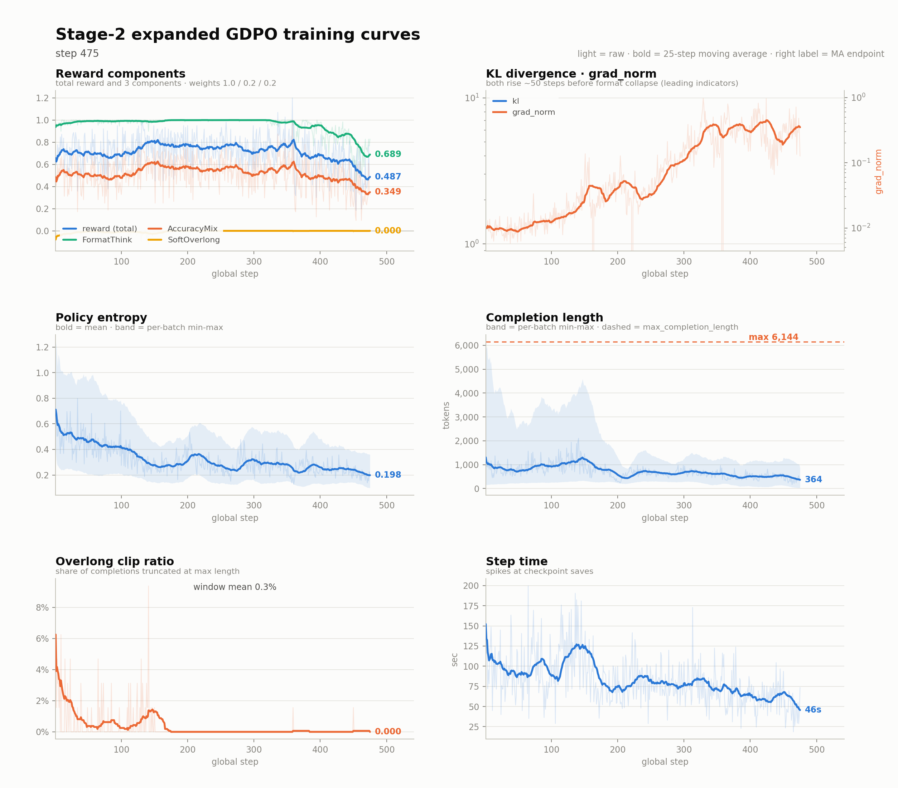
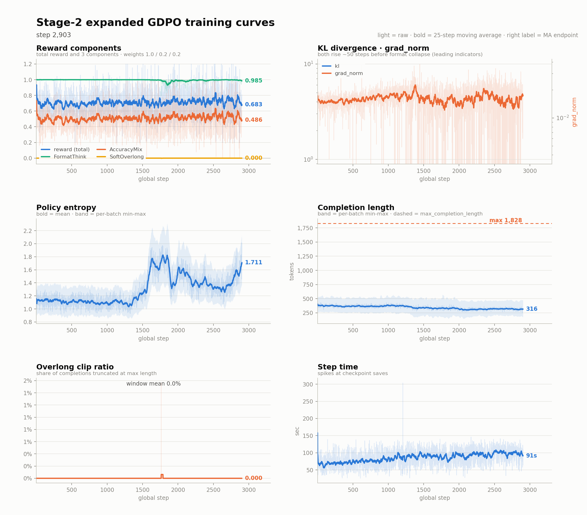
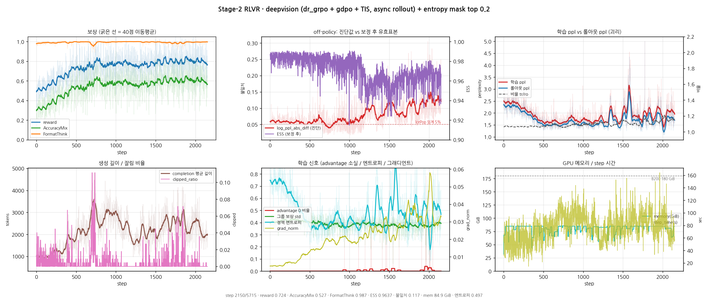
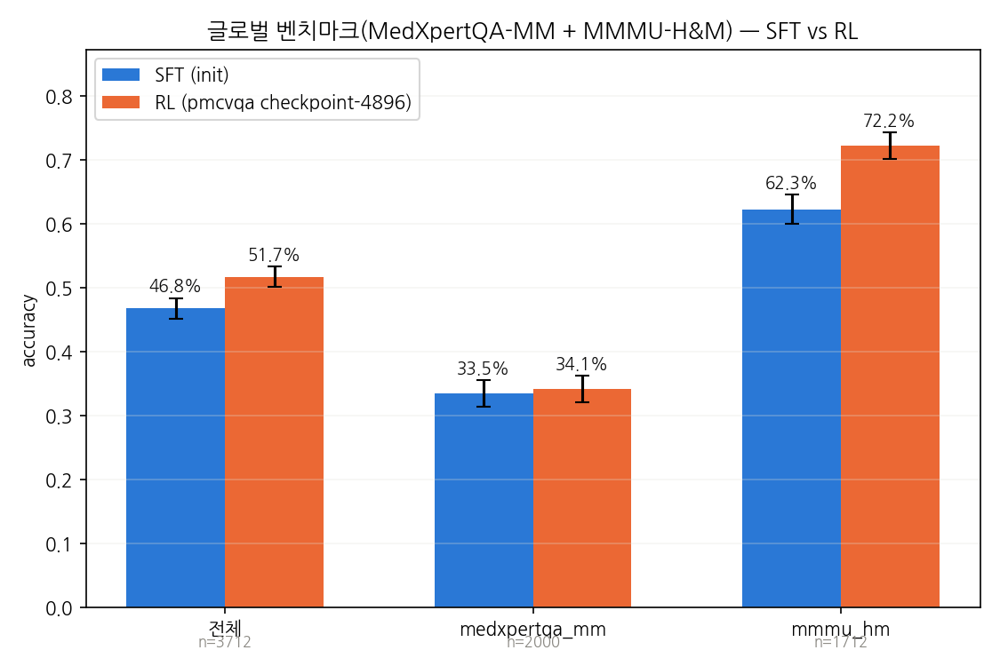

# K-BDS 의료 멀티모달 교차추론 — 학습 파이프라인

이 프로젝트는 계획서(`plan.hwp`)를 따릅니다. 학습은 **ms-swift** 로 실행합니다. 실행 환경은 KISTI Slurm 클러스터입니다.
파이프라인은 4단계입니다: **① 콜드스타트 SFT → ② 범용 RLVR/GRPO → ③ 의료 특화 RL(RaR) → ④ 평가**.

이 문서는 현황, 요약, 진입점을 설명합니다. 과거 실행과 붕괴 분석은 [문서 지도](#문서-지도)의 문서에 있습니다.
계정 이식과 인수인계는 [`HANDOFF.md`](HANDOFF.md)를 참조하십시오.

---

## 용어

이 문서는 한 용어에 한 뜻만 사용합니다.

| 용어 | 뜻 |
|---|---|
| SFT | 정답 응답을 보여 주고 학습하는 지도 미세조정 |
| RLVR | 검증할 수 있는 정답을 보상으로 쓰는 강화학습 |
| GRPO | 같은 문항의 응답 여러 개를 서로 비교해서 학습하는 강화학습 알고리즘 |
| RaR | 루브릭(채점 기준표)을 보상으로 쓰는 방법 |
| CoT | 모델이 정답 전에 쓰는 긴 사고 과정 |
| step | 가중치 갱신 1회 |
| epoch | 학습 데이터 전체를 1회 사용하는 단위 |
| init | 학습을 시작하는 모델. 이름은 `sft_mixed_merged` |
| job | 클러스터에 제출한 작업 1개 |
| 체인 | 체크포인트에서 재개하는 job 을 이어서 제출하는 방식 |
| arm | 도메인 1개의 학습 실행. 스크립트 인자 이름 |
| 홀드아웃 | 학습에 쓰지 않은 평가 문항 |
| 붕괴 | 모델이 `<think>/<answer>` 형식을 지키지 못하는 현상 |
| FormatThink | `<think>/<answer>` 형식 준수를 나타내는 학습 로그 지표 |
| watchdog | FormatThink 의 50 step 평균이 0.85 미만이면 job 을 자동 취소하는 감시자 |
| entropy | 모델 출력의 불확실성. 값이 낮으면 출력이 한 가지로 모임 |
| advantage | 샘플의 학습 신호. 값이 0 이면 그 샘플에서 배우지 않음 |
| pp | 퍼센트포인트. 두 비율의 차이 |
| pass@k | 문항당 k 번 시도해서 한 번이라도 맞히는 비율 |

---

## 현황 (2026-09-04)

**지금 위치**: Stage-2 도메인 전문가 3종을 학습하는 중입니다.
deepvision 과 pmcvqa 는 끝났습니다. mmk12 는 방치 상태입니다.

**deepvision** (B200)
- 엔트로피 마스크(`top_entropy_quantile=0.2`)를 사용했습니다.
- 붕괴 없이 2,203/5,715 step(38.5%)까지 학습했습니다.
- 자원을 회수해야 해서 학습을 중지했습니다.
- 교정한 홀드아웃 재평가(job `76330`)로 효과를 확정했습니다. 이 평가는 `EVAL_MAXTOK` 를 2048 에서 8192 로 올렸습니다.
- 정확도는 init **35.19%** 에서 **67.39%** 로 올랐습니다(**+32.20pp**, job `76330` 측정). 10월에 init 기준선만 다시 쟀습니다(KISTI job `82983`, `EVAL_MAXTOK` 8192). 그 기준으로는 init 35.8% → 67.4%(+31.6pp)입니다([Stage-2 전문가 문서](docs/stage2_experts.html#selection) A.3).
- format 준수율은 91.3% 에서 **97.8%** 로 올랐습니다.
- 이전 format 값 60.7% 는 착시였습니다. 출력이 2048 토큰에서 잘려서 생긴 값입니다.

**pmcvqa** (KISTI)
- 4,896/4,896 step(100%)을 완주했습니다.
- 효과는 작습니다. 정확도는 init 56.5% 에서 58.0% 로 올랐습니다(+1.5pp).
- 중간 체크포인트(step2850)는 60.5% 로 더 높습니다.
- pass@k 진단(job `76491`)에서 모델의 지식은 충분했습니다(pass@8 83%).
- RL 이 그 지식을 끌어내지 못했습니다. 원인은 지식 부재가 아니라 학습 신호입니다.

**mmk12** (KISTI)
- checkpoint-450 부근에서 같은 붕괴가 3번 연속 발생했습니다.
- 8/22 이후 방치했습니다.
- entropy 는 0.459 에서 0.204 로 단조 감소했습니다.
- `top_entropy_quantile=0.2` 는 deepvision 에는 충분했습니다. mmk12 에는 부족했습니다.

상세 내용: [Stage-2 도메인 전문가 3종 — 진행 현황](#stage-2-도메인-전문가-3종--진행-현황)

---

## Stage-2 도메인 전문가 3종 — 진행 현황

deepvision 은 B200 클러스터에서 학습합니다. mmk12 와 pmcvqa 는 KISTI 에서 학습합니다.

### 공통 설정

세 도메인은 같은 설정을 사용합니다. B200 붕괴 재현 실험에서 이 값들을 검증했습니다.

- `top_entropy_quantile=0.2` (엔트로피 마스크)
- `beta=0`
- `scale_rewards=gdpo`
- `lora_dropout=0`
- `lora_rank=16`, `lora_alpha=32` (계단 0 에서 어댑터를 병합하기 위한 값)
- init: `sft_mixed_merged`
- watchdog 사용

도메인마다 다른 설정은 길이 예산(`soft_max`)뿐입니다.

| 도메인 | `soft_max` | 이유 |
|---|---:|---|
| deepvision | 8192 | 긴 CoT |
| mmk12 | 6144 | 긴 CoT |
| pmcvqa | 3072 | 객관식 |

### 도메인별 상태

| 도메인 | 클러스터 · job(체인) | 데이터 | 목표(1 epoch) | 현재 | 상태 |
|---|---|---:|---:|---:|---|
| **deepvision** | B200 | 40,000 | 5,715 step | **2,203 (38.5%)** | 홀드아웃으로 효과 확정(job `76330`). 정확도 35.19% → **67.39%**(+32.20pp, job `76330` 측정. 10월 init 재측정 job `82983` 기준 35.8%). format 97.8% |
| **mmk12** | KISTI 75776→75777→75778 | 15,204 | 3,801 step | **475 (12.5%)** | checkpoint-450 부근에서 같은 붕괴 3연속(FormatThink). watchdog 이 자동 취소. 8/22 19:09 이후 방치. 결정 대기. entropy 0.459 → 0.204 단조 감소 |
| **pmcvqa** | KISTI 75774→75825→75826→76262 | 19,583 | 4,896 step | **4,896 (100%, 완주)** | 붕괴 없이 완주. 효과 미미: 56.5% → **58.0%**(+1.5pp). pass@8 83% 로 개선 여지 확인(job `76449`, `76491`) |






### mmk12 붕괴 분석

붕괴 원인은 resume 버그가 아닙니다.

- 최초 실행(75776)은 재개가 아니었습니다. 이 실행도 step 450 에서 FormatThink 가 0.847 로 내려가 문턱(0.85)에 닿았습니다.
- checkpoint-450 자체가 붕괴 초입입니다. 재개할 때마다 같은 자리로 돌아갑니다.
- 엔트로피 마스크는 deepvision 을 지켰습니다. mmk12(수학, 긴 CoT)에는 부족했습니다.
- 학습 로그의 `entropy/mean` 은 0.459(step ~50)에서 0.204(step ~460)로 단조 감소했습니다.
- deepvision 의 `entropy/mean` 은 1.1~1.9 로 유지되었습니다.
- `frac_reward_zero_std` 는 붕괴 직전에 0.000 이 됩니다. 이 값은 모든 롤아웃이 같은 퇴화 출력을 낸다는 뜻입니다.

### pmcvqa 효과 분석

pmcvqa 는 붕괴하지 않았습니다. 순효과는 작습니다.

- 1 epoch 을 완주했습니다(checkpoint-4896). 홀드아웃 평가는 job `76449` 입니다.
- 정확도는 init 56.5% 에서 58.0% 로 올랐습니다(+1.5pp). n=400 이므로 이 차이는 노이즈 범위 안입니다.
- 중간 체크포인트(step2850)는 60.5% 입니다. 최종 체크포인트가 더 낮습니다.

pass@k 진단(K=8, temperature=1.0, job `76491`)은 원인을 보여 줍니다.

- pass@1 은 **51.75%** 입니다. pass@8 은 **83.0%** 입니다(+31.25pp).
- 문항의 60% 는 중간 성공률입니다. 같은 문항을 운에 따라 맞히거나 틀립니다.
- 모델이 정말 모르는 문항은 17% 뿐입니다.
- 결론: 모델의 지식과 추론 능력은 충분합니다. RL 이 이 잠재력을 끌어내지 못했습니다.

학습 로그는 같은 결론을 지지합니다.

- `frac_reward_zero_std` 의 평균은 **49.3%** 입니다(후반 20% 구간은 53.7%, deepvision 은 0.4%).
- 학습 내내 배치의 절반 가까이가 advantage 0 이었습니다.
- `entropy/mean` 은 1.1~1.9 로 건강합니다. 이 병리는 mmk12 의 붕괴와 다릅니다.
- 추정 원인: 4~5지선다 객관식은 결정 토큰이 이산적이어서 구조적 한계가 있습니다. 이 원인은 확정하지 못했습니다.

교차평가(job `76455`)도 실행했습니다. deepvision 학습 모델을 pmcvqa 홀드아웃으로 평가한 결과는 **56.75%** 입니다. 이 값은 init 과 같습니다.
망각도 전이도 없습니다. 도메인 분리 전략은 안전합니다.

### 글로벌 벤치마크 (pmcvqa 모델)

과제계획서가 약속한 지표입니다. pmcvqa 모델로 평가를 완주했습니다.

- job: `77389`(SFT) → `77390`(RL)
- 체크포인트: `expert_pmcvqa_0821-2028/checkpoint-4896`
- 대상: MedXpertQA-MM + MMMU-H&M (n=3,712)
- 결과: SFT **46.77%** → RL **51.67%** (+4.9pp)
- mmmu_hm 이 이득을 이끌었습니다: 62.27% → **72.2%** (+9.9pp).
- medxpertqa_mm 은 거의 변하지 않았습니다: 33.5% → 34.1% (+0.6pp).
- 글로벌 벤치 이득(+4.9pp)이 도메인 홀드아웃 이득(+1.5pp)보다 큽니다. 분포가 다른 문항에서 효과가 더 크게 나타납니다. 원인은 확인하지 못했습니다.
- 평가 스크립트: `scripts/eval_global_bench.py`

### deepvision 이어학습 크래시 (KISTI)

KISTI 에서 deepvision 이어학습을 시도했으나 즉시 크래시했습니다.

- 시작점: B200 checkpoint-2192
- 설정: `RECIPE=dapo`, job `77210`, 출력 `expert_deepvision_continued_0904`
- 증상: 모든 rank 가 `torch.load` 에서 `UnpicklingError` 를 냈습니다.
- 원인: PyTorch 2.6 이상은 `weights_only=True` 가 기본값입니다. 이 설정이 `rng_state_*.pth` 안의 numpy 전역(`numpy._core.multiarray._reconstruct`)을 거부합니다.
- 수정: 이 체크포인트는 자체 학습이 만든 신뢰할 수 있는 파일입니다. `scripts/pyfix/sitecustomize.py` 가 `torch.load` 의 기본값을 `weights_only=False` 로 되돌립니다. `runc.sh` 가 이 파일을 PYTHONPATH 맨 앞에 넣습니다.
- 검증: 로그인 노드에서 rng_state 7개를 모두 다시 로드했습니다.
- 상태: 재제출을 보류했습니다. 재개 여부와 recipe 는 사용자의 결정을 기다립니다.

### 왜 도메인을 3개로 나누는가

- 구 혼합 학습은 소스별 노출이 0.09 epoch 로 같았습니다.
- 도메인 전용 학습은 같은 step 에서 소스를 1.7~4.9배 더 많이 노출합니다.
- 이 구조는 Kimi K3 의 "넓은 도메인 3개" 원칙과 맞습니다.
- 소스별 LoRA 는 같은 rank(16)를 사용합니다. 나중에 어댑터 산술로 통합할 수 있습니다(계단 0).

근거와 대안 비교는 다음 문서에 있습니다.
- [DeepSeek-V4 방법론 채택](docs/stage2_design.html)
- [Stage-2 재설계](docs/stage2_design.html)
- [서베이](docs/stage2_design.html)

### 구 혼합 학습 경로 (73924/73925)

이 경로가 3분할 구조로 전환하는 계기였습니다.

- step 850 에서 init 대비 +8.18pp 에 도달했습니다(p<0.0001).
- step ~900 에서 형식이 붕괴했습니다.
- 의료(pmcvqa)는 여섯 지점 모두에서 개선을 검출하지 못했습니다(+0.75pp, p>0.5).

분석 전문: [사후분석](docs/stage2_mixed_run.html) · [중간 점검](docs/stage2_mixed_run.html)

---

## 파이프라인 4단계

| 단계 | 목적 | 데이터 | 방법 |
|---|---|---|---|
| **①** 콜드스타트 SFT | `<think>/<answer>` 형식을 주입하고 의료 추론의 시드를 만듦 | v3: OpenMedReason + VisualWebInstruct + VLAA 혼합 | LoRA SFT |
| **②** 범용 RLVR | 검증할 수 있는 정답으로 추론을 강화 | 소스별 3분할: deepvision 40,000 / mmk12 15,204 / pmcvqa 19,583 | GRPO `recipe=stable`(dr_grpo), `num_gen` B200 16 · KISTI/kgpu 8, init=`sft_mixed_merged`. 도메인별 전문가를 학습한 뒤 통합 |
| **③** 의료 특화 RL | 개방형 의료 VQA 추론 | medix-rl-data 51K | GRPO + RaR 루브릭 보상 |
| **④** 평가 | base 모델 대비 성능을 정량화 | 층화 홀드아웃, HealthBench | vLLM 추론과 채점 |

**공통 제약**
- KISTI 에는 NVLink 가 없습니다. 모든 단계에서 LoRA-DDP 를 사용합니다.
- glibc 가 2.17 입니다. 컨테이너 스택이 필요합니다. 현재는 loader 우회를 사용합니다.
- 로그인 노드에서 vLLM 이 동작하지 않습니다. 모든 GPU 작업을 컴퓨트 노드에서 실행하십시오.

상세: [기술 레퍼런스](docs/ops_infra.html)

---

## 빠른 실행

### 주의

- **주의**: 노드는 정확히 3개입니다. arm 3개를 동시에 제출하면 파티션 전체를 점유합니다.
- **주의**: `num_generations` 는 계산량이 아니라 데이터 노출량을 줄입니다. KISTI 에서는 배치가 32 completion 으로 고정이고 상한은 8 입니다. B200 은 112 completion/step 이라 16 을 씁니다(HANDOFF §0).
- **주의**: 체인을 중단할 때는 관련 job 을 모두 `scancel` 하십시오. job 하나만 취소하면 다음 job 이 이어받습니다.
- **주의**: `MAX_STEPS` 의 단위는 step 입니다. epoch 으로 지정하려면 `EPOCHS=` 를 사용하십시오. 스크립트가 도메인별 데이터 건수로 step 을 계산합니다.

### Stage-2 도메인 전문가 학습

1. 데이터를 소스별로 3분할하십시오. 옵션은 `--dry` 와 `--verify` 입니다.
   ```bash
   python3 scripts/split_stage2_by_source.py
   ```
2. 5 step 스모크를 실행하십시오. 이 단계를 먼저 실행하십시오.
   ```bash
   SMOKE=1 bash scripts/launch_domain_experts.sh
   ```
3. 1 epoch 학습을 제출하십시오. 이 명령은 resume 체인 job 2개를 제출합니다.
   ```bash
   EPOCHS=1 N_JOBS=2 ARMS="mmk12 pmcvqa" bash scripts/launch_domain_experts.sh
   ```

### 모니터

```bash
squeue -u $USER                         # job 상태
tail -f logs/grpo_adv_*.log             # 학습 로그
cat logs/verdict_<JID>.json             # watchdog 판정. 붕괴 시 자동 생성
bash scripts/watch_expert.sh <arm>      # 상대 임계값 감시. 체인 전환을 arm 이름으로 자동 추적
```

### 학습 곡선 플롯

이 명령은 체인 로그를 자동으로 병합합니다.

```bash
./bin/python scripts/plot_train_curves.py logs/grpo_adv_<잡ID들...>.log -o docs/assets/<파일명>.png
```

### 중간 홀드아웃 평가

이 평가는 학습과 다른 파티션에서 실행합니다. 학습과 병렬로 실행할 수 있습니다.

```bash
sbatch --partition=1gpu --export=ALL,EVAL_STAGES=trained,TRAINED_TAG=<태그>,EVAL_N=all,\
EVAL_DATA=<도메인 전용 홀드아웃.jsonl>,MID_CKPT=<체크포인트 경로> scripts/eval_midtrain.slurm
```

### 단계별 단독 제출

각 단계는 `--dependency=afterok` 로 앞 단계에 연결합니다.

```bash
JID1=$(sbatch --parsable scripts/10_sft.slurm)                                   # Stage-1
JID2=$(sbatch --parsable --dependency=afterok:$JID1 scripts/20_rlvr_grpo.slurm)  # Stage-2
JID3=$(sbatch --parsable --dependency=afterok:$JID2 scripts/30_medical_rl.slurm) # Stage-3
sbatch          --dependency=afterok:$JID3 scripts/40_eval.slurm                 # 평가
```

---

## 문서 지도

| 문서 | 내용 |
|---|---|
| [`HANDOFF.md`](HANDOFF.md) | 인수인계 단일 문서. 계정 이식, 환경 함정, 실행 절차 |
| [`CLAUDE.md`](CLAUDE.md) | 실행 환경 가이드. KISTI 와 B200 두 클러스터의 검증된 절차와 함정 전체 |
| [`b200/README.md`](b200/README.md) | B200 실행 스크립트. deepvision 학습 결론(완료) |
| [`docs/stage2_design.html`](docs/stage2_design.html) | DeepSeek-V4 방법론 채택. 현재 도메인 3분할 구조의 근거. 통합(계단 0~2) 설계 |
| [`docs/stage2_design.html`](docs/stage2_design.html) | Stage-2 재설계. 서베이 기반 설정 변경 A~G |
| [`docs/stage2_design.html`](docs/stage2_design.html) | 최근 중국·한국 모델 테크리포트 서베이. 8종 학습 단계. 공통 패턴 7가지 |
| [`docs/stage1_coldstart.html`](docs/stage1_coldstart.html) | Stage-1 상세. v3 설계, 학습 곡선, 홀드아웃 평가, ablation |
| [`docs/stage2_mixed_run.html`](docs/stage2_mixed_run.html) | 구 혼합 학습 붕괴 사후분석(rev.2). 3분할로 전환한 계기 |
| [`docs/stage2_mixed_run.html`](docs/stage2_mixed_run.html) | 구 혼합 학습 중간 점검. 학습 곡선, 홀드아웃 추세, 검정력 분석 |
| [`docs/stage2_design.html`](docs/stage2_design.html) | Stage-2 실험. plateau 진단. GRPO 계열 5종 clean A/B |
| [`docs/stage2_design.html`](docs/stage2_design.html) | Stage-2 데이터. 소스 스크리닝, 혼합 비율, 빌드 파이프라인과 빌드 런북(§5-1) |
| [`docs/stage2_design.html`](docs/stage2_design.html) | RLVR 하이퍼파라미터. 외부 관행 대조. epoch 정책 |
| [`docs/stage3_eval.html`](docs/stage3_eval.html) | Stage-3 의료 RL(RaR 루브릭, judge). HealthBench 추적 |
| [`docs/stage3_eval.html`](docs/stage3_eval.html) | 의료 보상 스펙 |
| [`docs/ops_infra.html`](docs/ops_infra.html) | 환경, 베이스 모델, LoRA, 보상 설계, 논문 레퍼런스 |
| [`docs/ops_infra.html`](docs/ops_infra.html) | 자원·운영 정책. 데이터 소스. 홀드아웃 분리(누수 차단) |
| [`docs/ops_infra.html`](docs/ops_infra.html) | 진행 이력, 핵심 의사결정, 날짜별 기록, TODO |
| [`docs/ops_infra.html`](docs/ops_infra.html) | 일별 상세 로그(2026-06-15 ~ 07-01, 날짜별 절) |
| [`docs/experiments_all_stages.html`](docs/experiments_all_stages.html) | 전 단계 실험 정리(대표 개요, 2026-10-22 기준) |
| [`docs/stage2_experts.html`](docs/stage2_experts.html) | Stage-2 도메인 전문가: 학습·체크포인트 확정, 10월 붕괴 원인 추적(X1~X6), 전문가 통합(merging) |
| [`docs/kbds_2026-1_result_summary_draft.html`](docs/kbds_2026-1_result_summary_draft.html) | 결과보고서(연구요약서) 초안 |

---

## 파일 지도 (핵심)

```
scripts/
  00_common.sh                      공통 경로, 환경, run_py 래퍼. 이식할 때 PROJ_DIR 과 ENV_MODE 를 수정
  21_rlvr_grpo_adv.slurm            Stage-2 레시피(dapo|gspo|dr_grpo|stable). 모든 단계가 이 파일을 호출
                                    RESUME_CKPT=<경로>  재개
                                    WATCHDOG=1          감시자 켜기
                                    SEED=<n>            시드
                                    DOMAIN=<..>         도메인 프리셋
                                    PDTBS/ACCUM/NPROC_PER_NODE  노드 크기
  split_stage2_by_source.py         확장셋을 소스별 3분할(+sha1 manifest). --dry / --verify
  launch_domain_experts.sh          도메인 전문가 3 arm 제출. SMOKE=1 / ARMS=".." / EPOCHS=1 / N_JOBS=
  watch_expert.sh                   상대 임계값 감시. arm 이름으로 체인 전환을 자동 추적
  probe_answer_fallback.py          답 추출기 후보 측정(정밀도 × 복구율)
  plot_train_curves.py              학습 로그를 6패널 곡선과 구간 대조표로 변환(체인 로그 병합 지원)
  plot_holdout_paired.py            문항별 jsonl 을 궤적 + 짝지음 Δ 3패널로 변환
  eval_midtrain.slurm               중간 홀드아웃 평가(EVAL_STAGES 로 대상 선택, 병렬 제출 가능)
  eval_paired.py                    두 체크포인트의 문항별 점수를 조인. McNemar + 실측 검출 하한
  30_medical_rl.slurm · launch_stage3.sh · judge_server.sh    Stage-3
  50_eval_v3.slurm · eval_v3_holdout.py                       평가
configs/   accuracy.py(Stage-2 보상) · medical_reward.py(Stage-3 RaR)
runc.sh · bin/python                apptainer 우회 런타임(ENV_MODE=loader)
b200/      Jukyung-Yadok B200 실행 스크립트. 상세는 b200/README.md
work/      (git 제외) data · images · checkpoints · hf_cache
```

---

## 과제 종료 의무 (가이드 §7)

과제 종료 후 다음 기한을 지키십시오.

- **1주 이내**: 데이터를 다운로드하십시오. 이후에는 접근이 차단되고 데이터가 삭제됩니다.
- **1개월 이내**: 결과보고서와 산출물을 기탁하십시오(marketplace.kbds.re.kr).
- **2년 이내**: 사사 표기를 넣은 논문을 발표하십시오.

사사 문구:
- 한국어: *"이 논문은 K-BDS로부터 컴퓨팅 자원과 기술지원을 받아 수행된 연구성과임"*
- English: *"This work was supported by the Korea Bio Data Station(K-BDS) with computing resources including technical support"*
