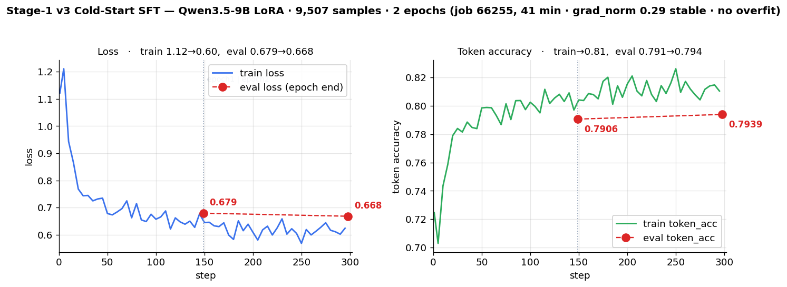

# Stage-1 · 콜드스타트 SFT — 상세

> 이 문서는 [`README.md`](../README.md) 에서 분리된 상세 기록입니다. 요약·현황은 README, 상세는 여기.

## Stage-1 · 콜드스타트 SFT

- **목적**: base(Qwen3.5-9B)가 본래 장문 추론(3.5~4.6K토큰)이라 잘림=0점이 RL 정체 원인 → **간결한 `<think>/<answer>` 형식**을 먼저 주입.
- **핵심 결정**: ZeRO-3 길이확대는 no-NVLink에서 5배 느려 불채택 → **간결 콜드스타트**로 해결.

**버전 이력** — 세 번의 재설계, 각각 실측으로 폐기/승계:

| | 데이터 | `format_think` | 결과 |
|---|---|---|---|
| **v1** `sft_coldstart_*` | VLAA **clevr_math 단일** 2,913 | — | ❌ 도메인 단일 → 일반화 실패, 폐기 |
| **v2** `sft_rft_coldstart_*` | 자기증류(RFT) **727** | **0.473** | ✅ 필수성 입증(ablation)·Stage-2 성공. 그러나 **형식 천장** |
| **v3** `sft_mixed_*` (현행) | 일반+의료 **혼합 9,507** | **1.000**(게이트 강제) | ✅ **생성 `format_think` 0.909 · acc 0.348** — 천장 완파 ([곡선](#v3-학습-결과--학습곡선-job-66255-2026-07-18) · [평가](#v3-홀드아웃-평가-결과--형식-천장-완파-job-69807-2026-07-20)) |

### v2 의 진짜 결함 — 데이터가 형식보상의 천장이었다 (2026-07-16 발견)

RL 이 최적화하는 `format_think`(`configs/accuracy.py`)는 **앵커 매칭**(`^<think>…</think>\s*<answer>…</answer>$`) + think 실질 16자↑ 를 요구한다. 이 함수를 **v2 학습 데이터에 그대로 돌린 결과**:

| 지표 | 값 |
|---|---|
| v2 데이터의 `format_think` | **0.473** |
| 구조 위반(`</think>` 뒤에 장문 후 `<answer>`) | 364/727 (**50.1%**) |
| `<think>` 가 사실상 빈 샘플 | 35 (4.8%, 그중 20이 객관식) |

**원인은 소스에 있다.** `build_rft_coldstart.py:78` 의 합격조건이 `AccuracyMix>=1.0 and closed(c) and len(c)<=6000` 인데, `closed()` = `'</think>' in c and <answer> 존재` 로 **앵커링도 최소 추론길이도 없다**(당시 롤아웃 로그엔 느슨한 `Format` 컬럼만 있었음). 게다가 선별이 **"가장 짧은 3개"**(`sorted(set(comps), key=len)[:3]`)라, 객관식에서 가장 짧은 정답 = `<think></think><answer>C</answer>` = **추론 없는 찍기**를 우선 선택한다(4지선다는 찍어도 25%가 AccuracyMix 통과).

→ 모델은 **절반이 틀린 형식**을 그대로 배웠고, 그래서 RL 시작 FormatThink 0.26 · 600스텝 후에도 **0.425 정체**. RL 이 못 배운 게 아니라 **초기화가 잘못 가르쳤다**.

### v1·v2 구축 상세 — RFT 콜드스타트 (job 57242, 2026-06-16)

*(구 `project_status_2026-07-05.md` 부록 A 에서 옮김. v2 결함은 위 절 참조.)*

**왜 필요했나**: base(Qwen3.5-9B VL)가 어려운 시각/기하 문제에 본래 **매우 길게 추론** → 4096/6144 토큰 budget으로도 **~50% 잘림 → 무답 0점**. RL·budget 조정으로 못 잡음 → **간결 추론 습관을 SFT로 재주입**.

**1차 (plain) 콜드스타트 — 폐기 (v1)**
- 스크립트 `build_coldstart_sft.py`. 데이터 = `UCSC-VLAA/VLAA-Thinking`의 **clevr_math** 서브셋(~5.9K). answer가 이미 `<think>…</think><answer>X</answer>` 형식이라 거의 그대로 사용 → `sft_coldstart_train.jsonl` **2913건**.
- **문제**: clevr_math가 너무 쉬움(평균 760자) → 어려운 시각/기하 문제로 **일반화 실패**(여전히 잘림).

**RFT란? (Rejection-sampling Fine-Tuning)** — 모델이 스스로 만든 답 중 **정답인 것만 골라(rejection sampling) 그걸로 다시 SFT**하는 자기증류(self-distillation) 기법. 외부 정답 데이터 없이 **모델 자신의 성공 사례로 부트스트랩**한다.
1. **생성(sample)**: 한 문제에 여러 후보 답(롤아웃)을 뽑는다.
2. **거절(reject)**: 검증가능 정답과 대조해 **틀린 것·형식 불량·잘린 것을 버린다**.
3. **정제(curate)**: 남은 정답 중 중복 제거·간결한 것 위주로 선별.
4. **재학습(fine-tune)**: 이 선별셋으로 SFT → 좋은 습관을 모델에 고정. (반복 시 STaR/ReST)

계보: STaR(Zelikman 2022) · ReST(Gulcehre 2023) · RFT(Yuan 2023) — 모두 "정답 롤아웃으로 SFT" 골격 공유. RL(GRPO)은 보상 gradient로 정책을 밀지만, RFT는 **정답 샘플만 남긴 offline SFT**라 싸고 안정적이다. 단 "정답을 더 잘 내게" 하기보다 **이미 낼 수 있는 정답을 원하는 스타일로 고정**하는 데 강함 → 콜드스타트(형식·간결성 주입)에 맞다. base는 어려운 문제도 **가끔 맞히긴 하나 장황해서 잘림** → 그 "가끔 맞힌 간결한 성공"만 골라 되먹인다.

**2차 (RFT) 콜드스타트 — v2**
- 스크립트 `build_rft_coldstart.py` (DeepVision 롤아웃에 RFT 적용). **소스**: 자기 GRPO 롤아웃 로그 `grpo_general/v*/completions.jsonl`.
- **필터 3중**: ① `AccuracyMix==1.0`(정답) ② `<think></think><answer></answer>` **정상 마감**(비잘림) ③ `len ≤ 6000자`(≈2000토큰, 간결). *(②가 느슨한 `closed()` 였던 것이 위 결함의 원인)*
- **선별**: 질문당 가장 짧은 것부터 **최대 3개**(`PER_Q=3`). 이미지 경로는 DeepVision 원본과 질문텍스트로 join.
- **결과**: `sft_rft_coldstart_train.jsonl` **727건** + val 40건 (ms-swift `{messages, images}` 포맷). *(worklog 06-16 의 "767예시"는 727 + val 40 이다)*

```
base Qwen3.5-9B + LoRA r16/a32 (all-linear)
727건 · 4 epochs · LR 1e-4 · max_len 4096 · bs1×grad_accum8 · 8GPU DDP
→ sft_rft_coldstart_lora/checkpoint-48
→ (merge, job 57245) sft_rft_coldstart_merged (18G)  ← 구 Stage-2 init
```

학습곡선 (48 step = 12 step/epoch × 4, 총 ~5분):

| epoch/step | train loss | val loss | val token_acc |
|---|---|---|---|
| step 1 | 0.263 | — | — |
| epoch 1 (step 12) | ~0.23 | 0.2149 | 0.9237 |
| epoch 2 (step 24) | ~0.19 | 0.2136 | 0.9236 |
| epoch 3 (step 36) | ~0.20 | 0.2137 | 0.9238 |
| epoch 4 (step 48) | 0.197 | 0.2138 | 0.9242 |

- **형식은 ~1 epoch에 수렴**: val loss가 epoch 1부터 0.214로 평탄(이후 ±0.001), token_acc 0.924 유지. 추가 epoch는 한계효용 작음(과적합 없음). 형식 주입이 목적이라 val 조기수렴은 정상 — **출력 스타일 정렬**이다. *(val 평탄의 다른 원인 = 질문 단위가 아닌 stride 분할 — 아래 v3 설계 5번)*
- **727건 샘플·길이 분포**: 예시(질문) *"Jewel2 … 특수 원소가 몇 개인가"*(시각논리 퍼즐) → `<think>보드 스캔·계산…</think><answer>N</answer>`. assistant 완성문 길이(문자) 중앙값 **2837** · 평균 2861 · 최소 36 · 최대 5979.
- **검증**: probe 추론(`probe_coldstart_think_true/false.jsonl`, `probe_rft_think_true.jsonl`)으로 형식 준수 확인. 후속 GRPO **FormatThink 0.05→0.27**(≈5배)·clip↓. 중간 홀드아웃(N=100) base 0.15 → init 0.22(형식 0.12→0.32, 길이 5907→5188자) — ⚠️ 0.22 는 소표본값이며 아래 동일조건 전량 재측정 0.295 로 대체됐다.

### v3 설계 — `scripts/build_mixed_coldstart.py`

**데이터 (전부 실측 검증 후 채택 — 이름·초록만 보고 고르지 않음)**

| 소스 | 샘플링 **목표** | 추론 중앙값 | ≤6000자 | 라이선스 | 역할 |
|---|---|---|---|---|---|
| `neginb/OpenMedReason` | 5,000 | 1,927자 | 100% | CC-BY-4.0 | **의료 신규 지식**(19 taxonomy) |
| `TIGER-Lab/VisualWebInstruct-verified` | 3,000 | 933자 | 100% | MIT | 일반, **자유형 정답 52.9%** |
| `UCSC-VLAA/VLAA-Thinking` (synthesis·clevr) | 2,500 | 649~934자 | 100% | Apache-2.0 | 일반, **이미 목표 형식** |

> ⚠️ 위는 **요청한 목표치**다. 게이트(`format_think==1.0`)와 풀 부족으로 **실제 채택은 9,889건**(VWI 는 difficulty-5 풀이 57건뿐이라 3,000→**2,390** 미달) → 실측 내역은 [학습에 쓴 데이터](#v3-학습-결과--학습곡선-job-66255-2026-07-18) 표 참조.

**왜 의료를 넣나**: `medix_rl_train`(Stage-3 데이터) 51,335건은 **assistant 가 통째로 비어 있다**(prompt+solution 만) → 프로젝트에 **의료 추론 트레이스가 0건**이었다. v1·v2 는 둘 다 일반(clevr/DeepVision) 전용이라 Stage-3 전이가 미검증 한계로 남아 있었음.

**설계에 반영한 6가지 (모두 위 결함의 직접 대응)**
1. **게이트 = `format_think == 1.0`** (느슨한 `closed()` 폐기) — v2 0.473 의 원인 차단
2. **OpenMedReason 정답위치 편향 제거** — 정답이 거의 항상 A 에 배치(**4지선다 A=77%, 5지선다 A=86%**) → 이미지 안 보고 A 만 찍어도 77~86%. 보기 셔플은 추론문 **29.6%**가 `option B` 식으로 문자를 참조해 불가 → **정답 문자별 균형 샘플링**(A/B/C/D 각 1,250)
3. **정답 정규화** — VLAA 는 `\boxed` 66%·`\[..\]` 76%·앞뒤공백 100%·일부는 `<answer>` 에 산문 통째 → 정규화 + 200자 초과 배제. `\boxed` 컨벤션은 이 프로젝트에서 폐기됨
4. **간결성 상한 6,000자** — 콜드스타트 존재이유가 잘림 차단
5. **질문 단위 train/val 분할** — v2 는 질문 정렬 후 stride 라 같은 질문의 형제가 양쪽에(val loss 가 4에폭 내내 0.2136~0.2149 평탄했던 원인)
6. **난이도 층화** — VWI `difficulty` 1~5 균등. v2 의 "가장 짧은 것" 선별은 찍기를 우선 선택했음

<details><summary>후보 스크리닝에서 탈락한 것들 (간결성이 기준)</summary>

`max_completion_length` 가 2048~6144 라 긴 trace 를 가르치면 **장황→잘림→형식0** 실패 모드를 재생산한다.

| 후보 | 추론 중앙값 | 판정 |
|---|---|---|
| `OpenDataArena/MMFineReason` 1.8M | **9,059~11,178자** | ❌ Qwen3-VL-235B-**Thinking** 증류라 장황함이 생성자 속성 — 쉬운 문제(pass_rate=1.0)만 골라도 9K. **RL 단계 후보로 보류**(`pass_rate` 난이도 라벨 유용) |
| DeepVision 자기수확(Stage-2 롤아웃 21,786건, 무료·in-domain) | 4,393자 (37.5%가 6K 초과) | ❌ RL 모델이 길게 추론하도록 학습된 출력 → 장황함을 재학습 |
| `leduckhai/S-Chain` | — | ❌ 10,783건인데 **고유정답 3개**(Non/Mild/Moderate-Dementia)·**고유질문 170개**·고정 3단계 템플릿 = 3지선다 반복. 또한 우리 파이프라인에 **grounding 보상이 없어** 아무도 채점 안 하는 행동 |
| `FanqingM/MMK12` · `MM-Eureka` · `ThinkLite-VL` | — | ❌ 이름과 달리 **추론 trace 자체가 없음**(RLVR용 prompt+answer) |
| `BoKelvin/GEMeX-ThinkVG`(=논문의 GEMeX-RMCoT, 개명) | — | ⏸ 텍스트만 공개 — 이미지는 **MIMIC-CXR(PhysioNet)** 자격심사+CITI+DUA 필요(수주). CC-BY-NC |
| `Xkev/LLaVA-CoT-100k`(170GB) · `Mulberry` · `Zebra-CoT` | — | ❌ 용량·형식(interleaved 시각 CoT)·NC 라이선스 |
</details>

### v3 학습 결과 — 학습곡선 (job 66255, 2026-07-18)

**① 학습에 쓴 데이터** — `scripts/build_mixed_coldstart.py` 빌드, **전량 `format_think==1.0` 게이트 통과분만** 채택 (빌드 로그 `logs/build_coldstart_66245.log`):

| 소스 | 채택 | 비고 |
|---|---|---|
| `neginb/OpenMedReason` | **4,999** | 의료. 정답문자 균형추출 A/B/C/D 각 1,250 (원본 A편중 77~86% 제거) |
| `TIGER-Lab/VisualWebInstruct-verified` | **2,390** | 일반. `difficulty` 1~5 층화 (5는 풀이 57건뿐이라 미달) |
| `UCSC-VLAA/VLAA-Thinking` · synthesis | **1,250** | 일반. 풀 19,257 → 채택 |
| `UCSC-VLAA/VLAA-Thinking` · clevr_math | **1,250** | 일반. 풀 5,923 → 채택 |
| **합계** | **9,889** | 고유질문 7,923 → **질문 단위** 분할: train **9,507** / val **382** |

**② 학습 설정 — v2 와 LoRA 세팅 완전 동일**(대조 조건 확보). 두 체크포인트의 `args.json` 직접 대조:

| 항목 | **v3 `sft_mixed`** | v2 `sft_rft_coldstart` | |
|---|---|---|---|
| base / tuner | Qwen3.5-9B / `lora` | 동일 | ✅ |
| `lora_rank` / `lora_alpha` / `lora_dropout` | **16 / 32 / 0.05** | 동일 | ✅ |
| `target_modules` / `modules_to_save` / `lora_bias` / `use_dora` | `all-linear` / `[]` / none / False | 동일 | ✅ |
| `learning_rate` / 스케줄 / `warmup_ratio` | **1e-4** / cosine / 0.03 | 동일 | ✅ |
| `max_length` / `max_pixels` | 4096 / 1003520 | 동일 | ✅ |
| dtype / `attn_impl` / `gradient_checkpointing` | bf16 / `flash_attn` / False | 동일 | ✅ |
| `weight_decay` / `seed` | 0.1 / 42 | 동일 | ✅ |
| **유효배치** | **64** (1×16×4gpu) | **64** (1×8×8gpu) | ✅ *(`grad_accum` 16 vs 8 은 GPU 수 보정 — 결과 동일)* |
| `num_train_epochs` | **2** | 4 | ⚠️ 아래 |
| **실제 옵티마이저 스텝** | **298** | **48** | ⚠️ 데이터량 차이 |

> **epoch 수가 다른 이유**: v2 는 727건뿐이라 4 epoch 을 돌려도 **48스텝**에 그친다. v3 는 9,507건이라 2 epoch 만으로 **298스텝** — 실제 학습량은 **약 6.2배**. epoch 을 2 로 줄인 건 v2 에서 **val 이 epoch1 이후 평탄**함을 확인했기 때문(`scripts/10_sft.slurm` 주석).
>
> ⚠️ 따라서 v3 의 우위는 **"데이터 품질" + "데이터량/학습스텝(48→298)"의 합산 효과**다. LoRA 하이퍼파라미터·LR·유효배치·시드가 전부 같으므로 **"튜닝 덕분"은 배제**되지만, 품질만 단독 분리한 것은 아니다.

소요: **41분 / 298스텝**(job 66255, 4gpu).

곡선·검증·안정성 모두 초록불:



**③ 스텝별 추이** (5스텝마다 로깅 60포인트 중 발췌 — 전량은 `work/data/sft_mixed_traincurve.json`)

| step | epoch | train loss | train token_acc | | step | epoch | train loss | train token_acc |
|---|---|---|---|---|---|---|---|---|
| 1 | 0.01 | 1.1220 | 0.7247 | | 175 | 1.18 | 0.5989 | 0.8172 |
| 25 | 0.17 | 0.7434 | 0.7840 | | 200 | 1.34 | 0.6091 | 0.8153 |
| 50 | 0.34 | 0.6782 | 0.7985 | | 225 | 1.51 | 0.6252 | 0.8080 |
| 75 | 0.51 | 0.6624 | 0.8014 | | 250 | 1.68 | **0.5683** | **0.8261** |
| 100 | 0.67 | 0.6571 | 0.8025 | | 275 | 1.85 | 0.6441 | 0.8042 |
| 125 | 0.84 | 0.6472 | 0.8054 | | 295 | 1.98 | 0.6241 | 0.8104 |
| **149** | **1.00** | — | — | | **298** | **2.00** | — | — |

> **valid 는 스텝마다가 아니라 epoch 끝 2회만** 측정된다(`--save_strategy epoch`). 그래서 위 표엔 step 149/298 의 train 값이 비어 있고, 아래 eval 표가 그 2 지점이다.

| 지표 | epoch 1 | epoch 2 | 판정 |
|---|---|---|---|
| train loss | 1.12 → ~0.62 | ~0.60 (전체 평균 **0.665**) | 초반 ~50스텝에 대부분 수렴 |
| **eval_loss** | 0.6793 | **0.6681** (−1.6%) | 악화 아닌 개선 → 과적합 아님 |
| **eval_token_acc** | 0.7906 | **0.7939** | 소폭 개선(epoch1 수렴) |
| train↔eval 격차 | ~0.66 vs ~0.67 | | 격차 거의 0 = **과적합 없음** |
| grad_norm | 평균 **0.29** (max 1.23, 마지막 ~0.27) | | 스파이크·발산·NaN·OOM 전무 |

- **재현**: `singularity exec $SB python scripts/plot_sft_curve.py docs/assets/sft_mixed_traincurve.png` (데이터 `work/data/sft_mixed_traincurve.json` ← `logs/sft_66255.log` 추출)
- ⚠️ **이 지표는 "학습이 안정적이었나"까지만 말한다.** token_acc 0.79 는 teacher-forcing 다음토큰 정확도지 생성 정답률이 아니다. v3 의 핵심 질문 — 생성시 **strict `format_think`**(v2 데이터 0.473 천장 돌파 여부)와 **홀드아웃 정답률**(v2 콜드스타트 0.22 대비) — 은 병합+평가 **job 69807**(`scripts/50_eval_v3.slurm`, `scripts/eval_v3_holdout.py`)가 답한다.

### v3 홀드아웃 평가 결과 — 형식 천장 완파 (job 69807, 2026-07-20)

**평가에 쓴 데이터** — `work/data/deepvision_holdout.jsonl` = **DeepVision-103K 층화 홀드아웃 972건**(math **453** / vl **519**). `scripts/make_holdout.py` 로 분리했고 **학습에 절대 미사용**(Stage-2 도 `deepvision103k_trainonly.jsonl` 로 fresh 학습 → **누수 0**).

> ⚠️ 학습 중의 `sft_mixed_val.jsonl`(382)과는 **다른 셋**이다. val 은 학습셋과 **같은 분포**(질문 단위 분할)라 `eval_loss`/`token_acc` 측정용이고, 홀드아웃은 **학습에 안 쓴 분포**에서 **생성 정답률·형식**을 재는 용도다. 그래서 위(학습)와 아래(평가) 숫자는 서로 다른 것을 말한다.

병합(`sft_mixed_merged`) → vLLM serve → 홀드아웃 972건 **전량** 채점
(`scripts/50_eval_v3.slurm` + `scripts/eval_v3_holdout.py`, temp=0 · `max_tok` 2048 · system 동일).

**v2 도 동일 하니스로 재측정**(`52_eval_v2_baseline.slurm`, job 70671)해 A/B 를 못박았다 — 아래 v2·v3 는 같은 972건·temp0·`max_tok` 2048·system 으로 채점된 **완전 동일조건** 수치다:

| 지표 | **v3 `sft_mixed`** | **v2 `sft_rft`**(동일조건) | v2 **RL 이후**(step600) |
|---|---|---|---|
| **strict `format_think`** | **0.909** | **0.185** | 0.425 (on-policy) |
| loose format(`<answer>`) | 0.909 | 0.371 | — |
| **홀드아웃 accuracy** | **0.348** | **0.295** | 0.380 dr_grpo / 0.390 GDPO |
| ├ math (n=453) | 0.3245 | 0.3245 *(우연 동률)* | — |
| └ vl (n=519) | **0.368** | 0.270 | — |
| mean_chars / errors | **1,982** / 1 | 4,824 / 1 | — |

> **📌 "v2 ~0.22" 은 과거 소표본(N=100~200)값 — 폐기.** 전량(972) 동일조건 재측정 = **0.295**. 따라서 정답률 격차는 **+0.053(상대 +18%)**이며 **전부 vl(시각논리)에서 나온다**(math 는 우연히 동률). 반면 **형식은 v2-SFT 0.185 → v3 0.909 로 5배**(같은 하니스). v2 모델은 장황(4,824자)해 학습데이터(0.473)보다도 낮게 생성되고, 이 장황함이 1차 재측정(70342)을 TIMEOUT 시킨 원인이자 RL 단계 잘림→형식0 의 근원이다.

**v3 재설계의 두 가설이 모두 실측 입증됐다.**

1. **형식 천장은 데이터 문제였다 (압도적·명확).** 같은 하니스로 v2-SFT 생성 `format_think` **0.185** vs v3 **0.909** — **5배**. RL 한 번 없이 v3 SFT 만으로 v2 의 *RL 이후*(0.425)마저 2배 상회. "RL 이 못 배운 게 아니라 초기화가 잘못 가르쳤다" 확정.
2. **정답률도 올랐으나 폭은 온건하고 vl 편중.** v3 0.348 vs v2 0.295 = **+0.053(+18%)**, 전부 **vl(0.270→0.368)**에서 나오고 **math 는 동률**(혼합 데이터가 객관식 추론은 개선, 수치계산은 불변). 그럼에도 v3 는 **RL 없이 0.348** 로 v2 가 풀 Stage-2 RL 로 도달한 0.380~0.390 에 근접 → Stage-2 한계효용 재검토는 유효.
3. **간결성이 실전 이점.** v3 1,982자 vs v2 4,824자(절반). RL 롤아웃에서 잘림→형식0 을 안 만드는 핵심.

**⚠️ 오염 비대칭 — 이 비교는 v3 에게 보수적이다.** 홀드아웃 972건 중 **214건(22.0%)이 `trainonly` 와 완전중복**이다(질문+이미지 바이트해시+정답 동일 → [알려진 한계](ops_data.md#홀드아웃-분리-stage-2-평가-누수-차단)). 느슨한 기준(질문+정답만 일치)으로 재측정하면 **301건(31.0%)** — 22% 가 검증된 하한, 31% 가 질문 수준 상한이다. 그런데 이 오염의 **"이득"은 DeepVision 을 학습한 모델에만** 돌아간다:

| 모델 | DeepVision 학습 여부 | 22% 오염 이득 |
|---|---|---|
| Stage-2 GRPO (0.380 / 0.390) | ✅ `trainonly` 전량 | **있음** (상향편향) |
| v2 콜드스타트 (동일조건 0.295) | ✅ DeepVision 자기증류 727건 | 일부 있음 |
| **v3 `sft_mixed` (0.348)** | ❌ **OpenMedReason + VWI + VLAA 만 — DeepVision 0건** | **없음** (완전 미학습 분포) |

즉 **v3 는 한 번도 본 적 없는 분포에서 0.348 을 냈고, 비교 대상들은 22% 를 외운 상태의 점수다.** → 위 표의 격차는 **실제보다 축소**되어 있을 가능성이 높다. (오염분 층별: vl 167 / math 134)

- 잔여 형식위반 **9.1%(88건)** 는 주로 **2048토큰 잘림**(`</answer>` 전 절단) → `max_new_tokens` 상향 여지.
- 채점은 RL 보상과 **동일 규칙**(템플릿 `response_prefix='<think>\n'` 전제 + `configs/accuracy.py:FormatThink` 와 같은 앵커·16자 조건). 예측 덤프 `logs/eval_v3_preds_69807.jsonl` 로 표본 검증함.
- ✅ **v2 동일조건 재측정 완료**(job 70671, 2026-07-21): acc **0.295** / `format_think` **0.185**. 과거 "~0.22"(소표본)를 대체 → A/B 확정. (1차 70342 는 v2 장황함에 `--time 1:20` TIMEOUT → 2:30 재제출로 완주.)

### 콜드스타트 Ablation Study (순가치 확정, 2026-07-09)

*(v2 데이터 기준. **결론은 v3 에도 유효** — 절제변수가 "콜드스타트 init 유무"라 데이터 버전과 무관하게 "콜드스타트 없이는 RL 이 형식을 못 배운다"를 보인다. v3 는 이 결론을 더 강화하는 방향: v2 조차 형식 0.473 이었는데도 필수였으므로.)*

계기: 콜드스타트의 HealthBench(0.224)가 base(0.229)와 동률이라 "Stage-1 제껴도 되나?" → clean ablation 으로 확정. 상세 = 아래 [학습 경과·층별 결과](#ablation-상세--학습-경과층별-홀드아웃) 와 [적합성 판단](#v2-콜드스타트-적합성-판단-2026-07-08)(구 `stage1_coldstart_assessment.md` 에서 옮김).

- **가설**: H1 콜드스타트=RL 전제조건 vs H0 콜드스타트=가속일 뿐.
- **설계**: **절제변수 = 콜드스타트 init 유무**, 나머지(trainonly·dr_grpo·LoRA·보상·하이퍼) 전부 통제. `base→RL`(dr_grpo·GDPO 2-arm, step200, `59946`/`59970`) vs 기존 콜드스타트 경로.
- **결과 — DeepVision 홀드아웃 2×2 (콜드스타트 × RL)**:

  | | RL 無 | RL 有 | RL 효과 |
  |---|---|---|---|
  | **콜드스타트 無** | base 0.15 | base→RL(200step) **0.18** | +0.03 |
  | **콜드스타트 有** | 0.22 | +RL(600step) **0.38** | **+0.16** |
  | **콜드스타트 효과** | +0.07 | +0.20 | |

  *(콜드스타트 無 RL: dr_grpo 0.18 / GDPO 0.165 — GDPO도 붕괴 못 살림)*

- **결론 — H0 기각, H1 채택**: **강한 상호작용**(RL 이득은 콜드스타트에 조건부: +0.16 vs +0.03). 콜드스타트 없이는 **FormatThink 100스텝 내내 ~0 정체**(콜드스타트 0.26 시작)·잘림 40%·학습 2~3배 저속, **200step RL이 콜드스타트 SFT 한 번(0.22)에도 못 미침**. → **Stage-1 필수 확정**. HealthBench 동률은 오프타깃(텍스트 의료)일 뿐.

#### Ablation 상세 — 학습 경과·층별 홀드아웃

*(구 `stage1_coldstart_assessment.md` §3.2·§3.4 에서 옮김)*

- **설계**: `21_rlvr_grpo_adv.slurm` 에서 `INIT_MODEL` 만 교체. 처리군 `INIT_MODEL=base(raw Qwen3.5-9B)` → dr_grpo & GDPO 2-arm, MAX_STEPS=200(`59946`/`59970`). 대조군 = 기존 콜드스타트 경로(RL0% 0.22, step600 0.38). 측정 = training dynamics + checkpoint-200 병합 → DeepVision 층화 홀드아웃 N=200(`47_eval_ablation.slurm`).
- **명분의 근거**: base 파일럿은 답이 **77% 잘렸고** Format=0 이었다 → `<answer>` 미도달 → 보상 0 → advantage 0 → RL 이 오를 언덕이 없다. base 는 HealthBench 에서 최대 44K자까지 장황했다.

**① training dynamics (step 1~100 구간평균)** — 콜드스타트 없이 RL 하면 형식이 안 붙는다:

| arm | FormatThink(1-25→76-100) | clip | AccMix | 대조(콜드스타트 init GRPO) |
|---|---|---|---|---|
| base→dr_grpo | 0.001 → 0.004 | 0.54→0.43 | 0.42→0.48 | Format **~0.26 시작** |
| base→GDPO | 0.002 → 0.002 | 0.46→0.41 | 0.47→0.46 | (동일) |

**② 홀드아웃 (checkpoint-200, N=200)**:

| 모델 | Acc | math | vl | 형식 |
|---|---|---|---|---|
| base→dr_grpo (콜드스타트 無) | **0.18** | 0.137 | 0.219 | 0.205 |
| base→GDPO (콜드스타트 無) | **0.165** | 0.137 | 0.190 | 0.19 |
| *(참조) 콜드스타트 RL0%* | 0.22 | — | — | 0.32 |
| *(참조) 콜드스타트+dr_grpo step600* | 0.38 | 0.358 | 0.400 | 0.425 |

- AccMix 소폭 상승(0.42→0.48)은 관대 파서가 형식 없이 답만 잡은 것 — 형식·간결 학습은 실패. GDPO(0.165)도 dr_grpo(0.18)보다 낮다 — 보상별 정규화도 0 신호를 못 살린다.

#### v2 콜드스타트 적합성 판단 (2026-07-08)

*(구 `stage1_coldstart_assessment.md` §2 에서 옮김. 대상 = v2: RFT 727건 · 4 epoch · LoRA r16/a32)*

> **적합하다 — 단 "최소 기능(minimum viable) 콜드스타트"로서 적합**하며, 최적은 아니다. 명분(RL 인에이블)은 달성·입증, 효율·선별편향·Stage-3 전이엔 개선 여지.

**적합한 점**: ① 형식 주입 → RL 인에이블 → Stage-2 plateau 돌파(다운스트림 성공이 최종 검증) ② 1차 clevr_math(쉬움) 실패 후 DeepVision 자기 롤아웃으로 바꾼 판단 ③ 과적합 없음(val 평탄, token_acc 0.924).

**미흡·위험한 점**:
1. **4 epoch 과다** — val 이 epoch 1 에 이미 수렴(0.2149→0.2138). 1~2 epoch 충분(다만 ~5분이라 손실 미미). → v3 는 2 epoch.
2. **"가장 짧은 정답" 선별 → 쉬운 문제 편향 가능성** — 필터가 `정답 AND 간결`이라 모델이 이미 잘 푸는 문제에 쏠릴 수 있다. 어려운 문제의 간결화 전이는 간접 증거(FormatThink 5배·홀드아웃 +47%)뿐이었다. → 이후 찍기 편향으로 확인됨(위 v2 결함).
3. **727건·DeepVision 전용** — 규모 작고 도메인 단일. Stage-3(medix) 형식 전이 미검증. → v3 에서 의료 CoT 투입.
4. **순가치 clean ablation 부재** — 홀드아웃 정비 후 비교가 없었다. → 위 ablation 으로 해소.

권고(당시): 재학습 시 epoch 1~2 + 어려운 문제 비중 상향 + medix 형식 소량 혼합 검토. HealthBench 상세(instr +0.044, 평균 8.9K자, judge 파싱실패 9.9%→5.0%)는 [`stage3_and_eval.md`](stage3_and_eval.md#단계별-추적--healthbench-hard-n1000).

---
